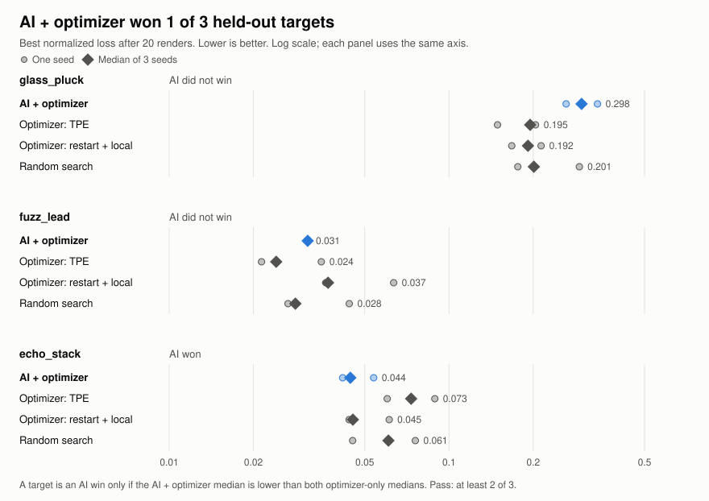

# SonicDNA

SonicDNA is an autonomous sound-design lab. It takes a short reference sound and works out an editable synth recipe for it through logged experiments. Sonic Alchemy then transforms that recipe while keeping its pitch.

**Live demo: https://sonicdna-ufq0.onrender.com**

Built for the Meta Global AI Developer Hackathon (Indie track). The output is a recipe you can read and edit, plus the record of every experiment behind it. A recipe is a plausible reconstruction, not proof of how the original sound was made.

## What the Meta model does, and what it doesn't

| Part | Done by | Notes |
|---|---|---|
| Structure: oscillator types, which effects are on, rough parameter regions | Muse (`muse-spark-1.3`) | 3-5 candidates per call, at most 4 calls per run |
| Fine-tuning continuous parameters | Numeric optimizer | Runs between planner calls, with no model involved |
| Pitch | `librosa.pyin` estimate | The model's schema has no pitch field |
| Rendering and scoring | Deterministic Python DSP | The same recipe always gives the same audio |
| Alchemy | Fixed rules and measurement | No model call; supports brightness and atmosphere only |

Every render in the experiment log records whether it came from the model, the optimizer or the deterministic fallback.

**Data use:** live AI runs send sound descriptors and a spectrogram image of the reference to Meta's model API. Raw audio isn't sent. Replays and Alchemy send nothing. Uploaded WAVs are stored on the server running SonicDNA, under `runs/live/uploads/`.

## Built during the hackathon

Everything in this repository was created during the hackathon. The first commit is dated Nov 3, 2026, and the commit history shows when each part was added:

- The synth renderer, audio features, loss and test sounds
- The Muse planner, optimizer loop and experiment logging
- The benchmark and held-out results
- The Next.js interface: Decode, Experiment Lab and Alchemy
- The API and public demo deployment

Open-source libraries are listed in `requirements.txt` and `frontend/package.json`. All audio in this repository is generated by SonicDNA's own synth. The code was written with Claude Code, under Albert Adeseye's direction, as the commit messages show.

## Results



We compared AI + optimizer against optimizer-only at the same budget of 20 renders, on 3 held-out synthetic sounds with 3 seeds each. **AI + optimizer won 1 of 3, so it did not meet our bar of 2 of 3.** That means we can't claim the AI outperforms the optimizer. Its contribution is directing the search and explaining each step.

Median best normalized loss, where lower is better:

| Target | AI + optimizer | Optimizer: TPE | Optimizer: restart + local | Random search | AI win? |
|---|---:|---:|---:|---:|---|
| `glass_pluck` | 0.298 | 0.195 | 0.192 | 0.201 | No |
| `fuzz_lead` | 0.031 | 0.024 | 0.037 | 0.028 | No |
| `echo_stack` | 0.044 | 0.073 | 0.045 | 0.061 | Yes, narrowly |

- The win rule was written down before the held-out run: AI had to beat both optimizer methods on a target. Against restart + local alone it won 2 of 3, and against TPE alone 1 of 3.
- All sounds are synthetic, made by our own engine. Recorded audio hasn't been evaluated.
- Normalized loss is a defined measurement of spectrum, brightness and level over time. It isn't accuracy, and it doesn't measure how alike two sounds seem to a listener. `app/loss.py` has the definition.

Seed-level numbers are in `demo/heldout_results.json`. To rebuild the chart from them, run `python scripts/make_chart.py`.

## Setup

You need Python 3.11, Node 20 or later, and a Meta API key for live AI runs only. Replay, optimizer-only runs and Alchemy work without a key.

```bash
python3 -m venv .venv
source .venv/bin/activate
pip install -r requirements.txt
cp .env.example .env   # add META_API_KEY for live AI runs
```

### Regenerate the reference targets

The reference sounds in `data/targets/` are not committed. This one script recreates all 12, plus their ground-truth recipes in `manifest.json`:

```bash
python scripts/make_targets.py
```

The app needs them before it starts. The script uses no randomness, so the audio samples come out identical every time. File hashes differ between runs because the WAV header holds a timestamp.

## Run the app

In one terminal, start the API:

```bash
.venv/bin/uvicorn app.api:app --port 8000
```

In another, build and start the frontend:

```bash
cd frontend && npm install && npm run build && npm start
```

Then open http://localhost:3000.

### Replay the saved demo run

`demo/` holds one complete, real AI + optimizer run on a held-out target, with its reference and best-render WAVs. Point the API at it:

```bash
SONICDNA_RUNS_DIR=demo .venv/bin/uvicorn app.api:app --port 8000
```

The UI labels it as a replay, and it makes no model calls. It's `echo_stack`, the one target AI won, using that target's median seed. It isn't typical of all targets, so read it alongside the results above.

## Public demo

The hosted demo runs in public mode (`SONICDNA_PUBLIC=1`, set in the `Dockerfile`). It holds no Meta API key, so it can't make model calls, and it stores no uploads. Visitors can replay the recorded AI run, edit recipes, use Alchemy and start optimizer-only runs. To start a live AI run or upload your own sound, run SonicDNA locally with your own key.

To run the same image locally:

```bash
docker build -t sonicdna-public .
```

```bash
docker run --rm -p 10000:10000 sonicdna-public
```

Then open http://localhost:10000.

To deploy on Render, choose **New > Blueprint** and connect this repo. `render.yaml` defines the service. Never add `META_API_KEY` to it or to the service's environment.

Measured in a container on an Apple Silicon Mac, limited to 512 MB. These numbers are from local limits, not from Render:

| | 0.1 CPU (Render Free) | 0.5 CPU (Render Starter) |
|---|---|---|
| Start until ready | 66 s | 5 s |
| First target analysis | 20 s | 1 s |
| Alchemy, three variants | 71 s | 3.6 s |
| 20-render optimizer-only run, after a 20 s or 1 s start | 6 s | 2 s |

## Tests and experiments

```bash
.venv/bin/pytest
```

```bash
cd frontend && npm test
```

The tests fake the network, so they need no key and make no billed calls.

```bash
python scripts/check_api.py   # one billed call, to confirm API access
```

```bash
python scripts/loss_curve.py   # random-search curves on the dev targets, no key needed
```

```bash
python scripts/benchmark.py --split dev --modes random,optimizer_only   # no key needed
```

Adding `hybrid` to `--modes` makes billed calls. Results for the held-out split are already recorded; rerunning it on changed code wouldn't be a fair held-out test.

## How it works

```
reference WAV → validate, resample, normalise loudness
  → features: log-magnitude STFT, brightness, level over time, onset, pitch
  → planner: Muse proposes 3-5 structures, validated against a schema and bounds
      (invalid reply → retry once → deterministic fallback)
  → render and score each candidate → log it
  → optimizer fine-tunes the best recipe → log it
  → next planner call, up to 4 → best recipe → Alchemy → export
```

| Path | What it holds |
|---|---|
| `app/dsp.py` | Deterministic renderer |
| `app/features.py`, `app/loss.py` | Measurement and composite loss |
| `app/planner.py`, `app/optimizer.py` | Muse calls and numeric search |
| `app/search.py` | Experiment loops and logging |
| `app/alchemy.py` | Brightness and atmosphere transforms |
| `app/api.py` | FastAPI layer for the frontend |
| `frontend/` | Next.js app: Decode, Experiment Lab, Alchemy |
| `demo/` | Saved run, its WAVs and the held-out results |
| `docs/` | Spec, build plan and chart |

## Limits

- The synth is small: 1-2 oscillators, ADSR envelope, low-pass filter, distortion and delay.
- It suits short, isolated, pitched sounds. Sounds with no clear pitch are refused.
- Alchemy can't do requests like "metallic" or "rhythmic pulse", and it says so instead of guessing.
